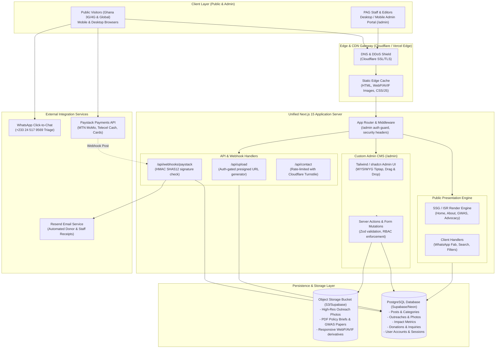

# System Architecture Specification: Psoriasis Association of Ghana (PAG)

**Document Version:** 1.0.0  
**Target Platform:** Web Application & Custom Admin CMS  
**Primary Domain:** `psoriasisgh.org`  
**Target Infrastructure:** Edge-Ready Serverless (Next.js 15, PostgreSQL, Cloud Object Storage, Paystack)

---

## 1. System Topology & Network Boundaries



---

## 2. Component Layer Breakdown

### 2.1 Public Frontend (Presentation Layer)
- **Rendering Strategy:** Static Site Generation (SSG) with On-Demand Incremental Static Regeneration (ISR via `revalidateTag`). 
- **Zero-Latency Design:** Pages load instantly from edge cache. When PAG staff edits a blog post or metric in the Admin panel, the server invalidates only the relevant tag (`revalidateTag('posts')` or `revalidateTag('metrics')`), avoiding cold rebuilds.
- **Payload Budget:** Initial page bundle < 120 KB JS. Minimal external dependencies; zero heavy client-side state engines.
- **Network Resilience:** Mobile-first responsive views optimized for standard Android viewport widths (360px–412px) prevalent in Ghana.

### 2.2 Custom Admin CMS (`/admin`)
- **Route Namespace:** Completely isolated under `/admin/*` routes.
- **State & Mutations:** Modern React Server Actions with optimistic UI updates.
- **Editor Engine:** **Tiptap** headless rich-text editor configured with:
  - Paragraphs, Headings (H2, H3), Blockquotes, Unordered/Ordered Lists.
  - Image insertion with responsive aspect-ratio preservation.
  - Link modal with validation.
  - Clean HTML/JSON export without proprietary blobs.
- **Feedback & State:** Toast notifications (via Sonner) indicating upload progress, save confirmations, and error diagnostics.

---

## 3. Database Architecture & Entity Relationships

The data model is structured in PostgreSQL via Drizzle ORM to maintain strict typing, foreign key constraints, and fast indexes:

```mermaid
erDiagram
    USERS ||--o{ POSTS : writes
    USERS ||--o{ AUDIT_LOGS : performs
    CATEGORIES ||--o{ POSTS : classifies
    OUTREACHES ||--o{ OUTREACH_IMAGES : contains
    
    USERS {
        uuid id PK
        string email UK
        string password_hash
        string full_name
        string role "super_admin | editor"
        boolean is_active
        timestamp created_at
        timestamp updated_at
    }

    CATEGORIES {
        uuid id PK
        string name UK
        string slug UK
        string description
    }

    POSTS {
        uuid id PK
        string title
        string slug UK
        text excerpt
        text content_html
        string cover_image_url
        uuid category_id FK
        uuid author_id FK
        string status "draft | published"
        timestamp published_at
        timestamp created_at
        timestamp updated_at
    }

    OUTREACHES {
        uuid id PK
        string title
        string slug UK
        string location "e.g. Tema Community 1, Kumasi"
        date event_date
        integer people_screened
        text summary
        string status "upcoming | completed"
        timestamp created_at
    }

    OUTREACH_IMAGES {
        uuid id PK
        uuid outreach_id FK
        string image_url
        string caption
        integer sort_order
    }

    DOCUMENTS {
        uuid id PK
        string title
        string slug UK
        string category "gwas_research | nhis_policy | annual_report"
        string file_url
        string file_size_display
        text summary
        integer download_count
        timestamp created_at
    }

    METRICS {
        string metric_key PK "e.g. gwas_participants, people_reached"
        string label
        string display_value "e.g. 3,000+"
        integer numeric_sort_order
        timestamp updated_at
    }

    DONATIONS {
        uuid id PK
        string paystack_reference UK
        decimal amount
        string currency "GHS | USD | EUR | GBP"
        string channel "mobile_money | card"
        string donor_name
        string donor_email
        string donor_phone
        string status "pending | success | failed"
        jsonb metadata
        timestamp created_at
    }

    INQUIRIES {
        uuid id PK
        string type "general | volunteer | media | medical_partner"
        string full_name
        string email
        string phone
        text message
        boolean is_addressed
        timestamp created_at
    }

    AUDIT_LOGS {
        uuid id PK
        uuid user_id FK
        string action "created_post | updated_metric | deleted_image"
        jsonb details
        timestamp created_at
    }
```



---

## 4. Media & Cloud Storage Pipeline

```
[ PAG Admin Uploads Image (JPG/PNG from Phone) ]
                      |
                      v
[ Client-Side Pre-validation (Max 15MB, Format Check) ]
                      |
                      v
[ Next.js API / Server Action: Presigned Upload Auth ]
                      |
                      v
[ Cloud Object Bucket (Supabase Storage / Cloudflare R2 / S3) ]
                      |
                      v
[ Automated Edge Image Transformation (Next.js Image Optimizer / Cloudflare) ]
  - Converts dynamically to WebP / AVIF
  - Generates responsive srcSets (360px, 640px, 1024px, 1920px)
  - Applies 80% compression (saving ~75% cellular data for Ghanaian visitors)
```

1. **Upload Handling:** Presigned POST URLs eliminate server CPU bottlenecks on the Next.js backend.
2. **Format Modernization:** Incoming photos (often 5MB–10MB phone snapshots from outreaches) are delivered to end users as lightweight **WebP/AVIF** files under 150KB.
3. **Document Repository:** PDF documents (GWAS research papers, NHIS policy whitepapers) are stored with `Content-Disposition: inline` and fallback download headers.

---

## 5. Security & Authentication Model

### 5.1 Route Protection & Sessions
- **Authentication Engine:** Secure HTTP-only, SameSite=Strict session cookies using modern cryptographic encryption (AES-256 via Auth.js or Supabase Auth).
- **Edge Middleware Protection:**
  ```
  Incoming Request -> /admin/*
    -> Check Session Cookie
    -> Invalid / Missing? Redirect to /admin/login
    -> Valid Session? Inject user context (ID, Role)
    -> Super Admin Only route (e.g. /admin/users)? Verify role == 'super_admin'
  ```
- **Password Security:** Scrypt or Argon2id hashing algorithms; no plain-text passwords ever touch memory buffers.

### 5.2 Form & API Hardening (OWASP Top 10)
- **Input Sanitization:** All incoming requests parsed through **Zod schemas** at runtime.
- **HTML Sanitization:** Blog posts created in Tiptap are sanitized with strict DOMPurify rules before rendering to prevent Cross-Site Scripting (XSS).
- **Bot Mitigation:** Public contact and volunteer inquiry forms guarded by **Cloudflare Turnstile** (non-intrusive CAPTCHA).
- **Rate Limiting:** IP-based and token-bucket rate limiting (via Upstash Redis or memory store) on `/api/contact` and `/admin/login`.

---

## 6. Payment & Mobile Money (MoMo) Architecture (Paystack)

```
[ Donor on /donate ]
        |
        v
[ Selects: Amount (GHS 50, 100, 250, 500, Custom) + Frequency (One-off / Monthly) ]
        |
        v
[ Client submits -> Next.js Server Action: Initialize Paystack Transaction ]
        |
        v
[ Paystack API returns Authorization URL & Reference ]
        |
        v
[ Donor enters MoMo Prompt (MTN / Telecel / AT) or Card ]
        |
        +-----------------------------------+
        |                                   |
(Donor completes on phone)          (Donor closes window)
        |                                   |
        v                                   |
[ Paystack Server sends Webhook ]           |
  POST /api/webhooks/paystack               |
        |                                   |
        v                                   v
[ Webhook Signature Verification ]     [ Expired / Abandoned ]
  crypto.createHmac('sha512', SECRET)
        |
    [ Matches? ]
     /        \
   YES         NO -> HTTP 401 Unauthorized
   /
  v
[ Idempotency Check (Check reference in DONATIONS table) ]
  - If already processed -> Return HTTP 200 (avoid double credit)
  - If new -> Mark status = 'success', record metadata
        |
        v
[ Trigger Automated Thank-You & Tax Receipt Email (Resend) ]
```

---

## 7. Performance & Caching Strategy for Sub-Saharan Africa

| Optimization Vector | Implementation Strategy |
| :--- | :--- |
| **Edge CDN Caching** | Public pages cached at Cloudflare / Vercel Edge nodes in Accra and Lagos. Latency < 40ms. |
| **Asset Compression** | Gzip & Brotli encoding enabled across all text, CSS, and JS payloads. |
| **Font Optimization** | System UI fonts (Inter / Geist) preloaded with zero layout shift (`font-display: swap`). |
| **Data Fetching** | Server-side data fetching with tag-based revalidation (`next: { tags: ['posts', 'metrics'] }`). Zero client-side loading spinners on initial landing. |
| **Offline Resilience** | Service worker caching critical educational content so patients can re-read condition guidelines even with intermittent connectivity. |

---

## 8. Environments & Deployment Pipeline

```
[ Local Development (Windows / Node.js 22 LTS) ]
                      |
                      v Git Push to GitHub (main)
[ GitHub Actions / Automated CI ]
  - TypeScript Compiler Verification (`tsc --noEmit`)
  - Linting & Prettier Format Checks
  - Security Vulnerability Audit
                      |
                      v Auto-deploy
[ Production Edge Infrastructure (Vercel / Cloudflare) ]
  - Environment variables encrypted in host vault (PAYSTACK_SECRET, DB_URL, AUTH_SECRET)
  - Zero-downtime rolling deployments
```
